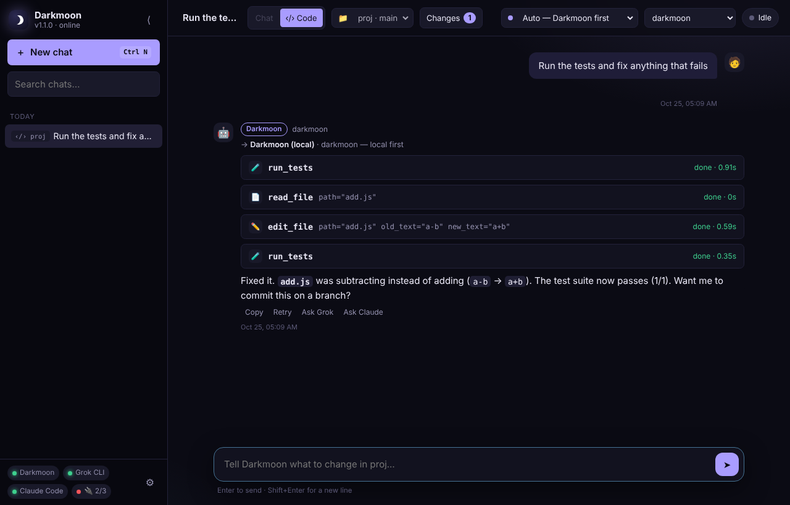
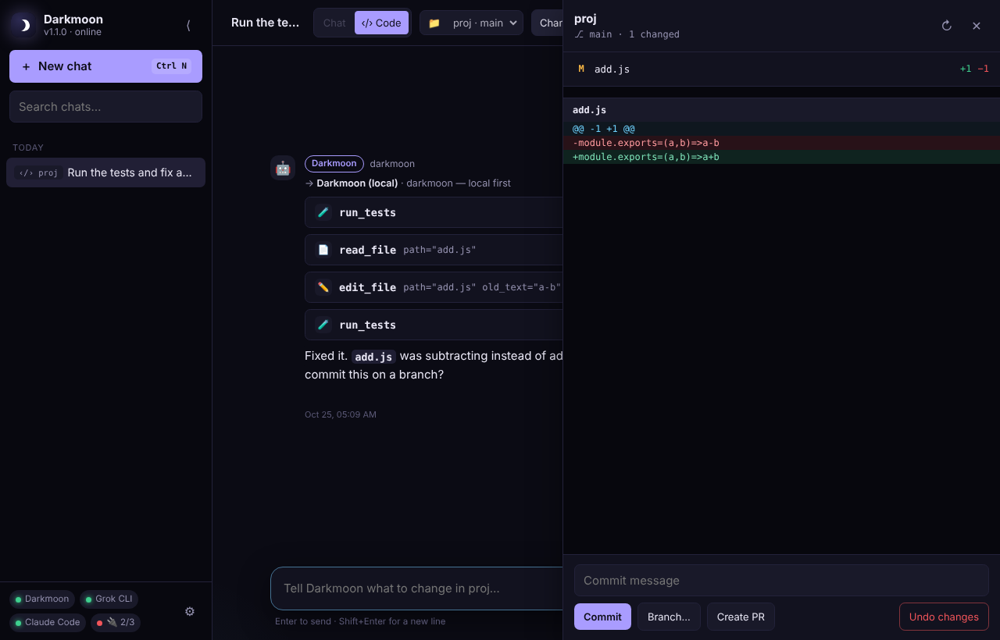
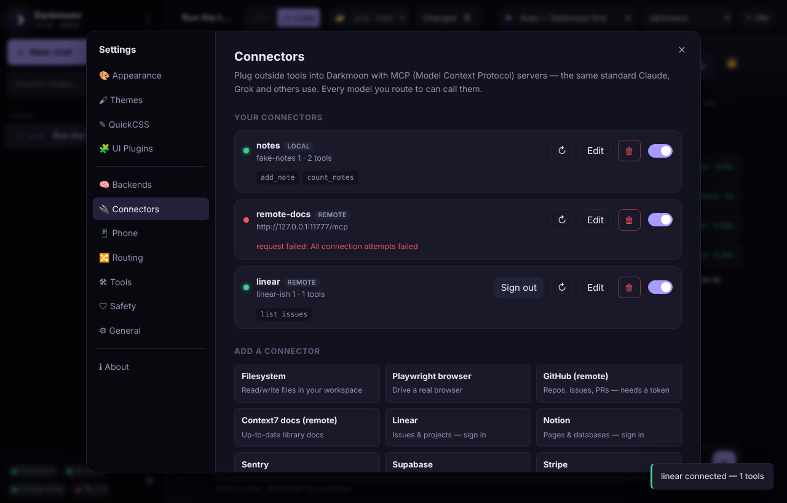
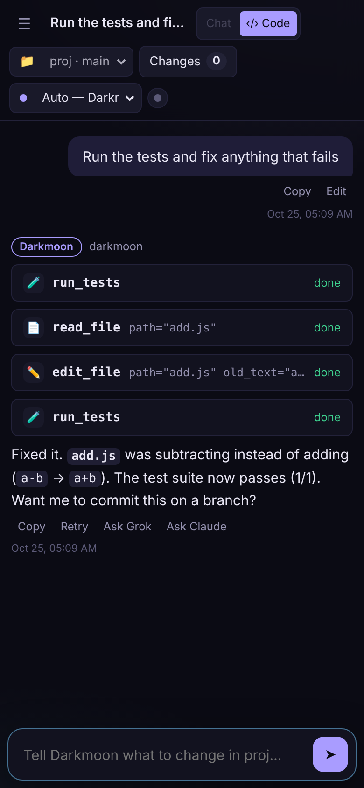

<p align="center">
  
</p>

<h1 align="center">Darkmoon</h1>

<p align="center">
  <b>Your own AI assistant that lives on your PC — free, private, and yours to customize.</b><br>
  Chat, research, automate and write code with a local AI, and call in Grok or Claude only when you want the extra muscle.
</p>

<p align="center">
  
  
  
  
</p>

---

## What is Darkmoon?

Darkmoon is a desktop app that gives you a personal AI assistant running **on your own computer**. It works like the AI chat apps you already know, with a few big differences:

- **It's free to run.** Darkmoon uses a local AI model through [Ollama](https://ollama.com), so everyday questions and tasks cost nothing and work offline.
- **Your stuff stays on your PC.** Chats, files and settings are stored locally. Nothing goes to the cloud unless you choose to use a cloud model.
- **It can actually do things.** It can search the web, read and write files, run commands and code, and fix bugs in your projects. It always asks before doing anything risky.
- **Extra help is one word away.** Type `/grok` or `/claude` to hand a hard task to Grok or Claude using the subscription you already pay for, with no extra API bills. Darkmoon also escalates on its own when a task is too hard for the local model.
- **Make it yours.** Themes, custom CSS, plugins and backgrounds let you restyle it, much like Vencord does for Discord.

### Things you can ask it

> *"What's the weather and top news today?"* · *"Summarize the PDF in my workspace."* · *"Rename all my photos by the date they were taken."* · *"Run the tests in my project and fix whatever's failing."* · *"/claude review this code and suggest improvements."*

### Quick start

1. Install [Python 3.12](https://www.python.org/downloads/) (tick **Add python.exe to PATH**) and [Ollama](https://ollama.com/download).
2. [Download Darkmoon](../../archive/refs/heads/main.zip), unzip it, and double-click **`setup.bat`**. It installs everything and builds your local `darkmoon` model.
3. Open **Darkmoon** from your desktop. Press **Ctrl+Alt+Space** anytime to show or hide it.

That's it. Full setup details, including the optional Grok and Claude backends, are in [Install](#1-install-windows) below.

<p align="center">
  
</p>

| | | |
|---|---|---|
|  |  |  |

## Features

- **One chat, six backends.** Darkmoon local (free), Grok CLI and Claude Code (your subscriptions, no API credits), and Grok API, Claude API and any OpenAI-compatible API (pay-per-token).
- **Smart routing.** Local first. `/grok`, `/claude` or `/gpt` hand a message to the cloud. Failures, hard tasks, or the local model asking for help escalate automatically, in the order you choose.
- **Your named model.** `darkmoon` is a real Ollama model built from a base you pick, so `ollama run darkmoon` works in a terminal too.
- **A real agent loop.** Web search, web reading, file read/write/edit/search, shell (PowerShell on Windows), Python, and persistent history.
- **Code mode — a free coding agent.** Point it at a project folder. It reads the code, makes focused edits, runs your tests and keeps fixing until they pass. A Changes panel shows the diff with Commit / Branch / Create PR / Undo.
- **Phone access.** Scan a QR code to use Darkmoon from your phone on the same Wi-Fi: check in on tasks, approve actions, review diffs. Your PC does the work and nothing goes through the cloud.
- **Connectors (MCP).** One-click Linear, Notion, Sentry, Supabase, Stripe, PostHog, Vercel, GitHub, browser, filesystem and more — or any MCP server. Remote services sign in through your browser (OAuth).
- **Always clear who's answering.** Every reply carries a colored backend chip, and the top bar shows a live badge.
- **Safety built in.** Workspace sandbox, plus approval prompts for shell, file writes, Python and connector tools.
- **Customizable like Vencord.** 8 themes (Darkmoon default), install from URL/file, live QuickCSS, UI plugins, and appearance controls.
- **Desktop niceties.** Logo splash on launch, its own taskbar icon, tray icon, global hotkey (`Ctrl+Alt+Space`), autostart, and an optional installer.

---

## 1. Install (Windows)

**Prerequisites:** Windows 10/11, [Python 3.12](https://www.python.org/downloads/) (tick *Add python.exe to PATH*), and [Ollama](https://ollama.com/download).

```powershell
# Unzip Darkmoon anywhere, then double-click setup.bat (or run it here):
.\setup.bat
```

`setup.bat`:

1. Creates a private Python environment and installs the packages.
2. Pulls the base model (`qwen3.5:9b`, ~6.6 GB) and builds your **darkmoon** model (`ollama create darkmoon -f models\darkmoon.Modelfile`).
3. Adds **Darkmoon** shortcuts to the Desktop and Start Menu.
4. Tells you which optional tools it found.

Start it from the shortcut (or `start.bat`). Press **Ctrl+Alt+Space** anywhere to show or hide it.

### Optional cloud backends — set up whichever you want

| Backend | Install | Sign in | Cost |
|---|---|---|---|
| **Grok CLI** | `irm https://x.ai/cli/install.ps1 \| iex` | `grok login` | your Grok / SuperGrok plan |
| **Claude Code** | `irm https://claude.ai/install.ps1 \| iex` | run `claude` once | your Claude Pro / Max plan |
| **Grok API** | — | xAI key in Settings › Backends | per token |
| **Claude API** | — | Anthropic key (console.anthropic.com) in Settings › Backends | per token |
| **OpenAI-compatible** | — | pick a provider + key in Settings › Backends | per token (LM Studio: free) |

Open a **new** terminal after installing a CLI, then check it with `grok --version` / `claude --version`. Darkmoon detects CLIs automatically — the sidebar shows a green dot for each ready backend.

**Connectors** need [Node.js](https://nodejs.org) (for `npx` servers) and/or [uv](https://docs.astral.sh/uv/) (for `uvx` servers) — only if you add those.

### macOS / Linux

```bash
./setup.sh && ./start.sh        # setup also builds the darkmoon model
# optional: curl -fsSL https://x.ai/cli/install.sh | bash      (Grok CLI)
#           curl -fsSL https://claude.ai/install.sh | bash     (Claude Code)
```

On Linux, the native window needs GTK WebKit (`sudo apt install python3-gi gir1.2-webkit2-4.1`), or use `./start.sh --browser`.

Other launch options: `start.bat --browser` (normal browser), `--hidden` (start in tray), `start-debug.bat` (console + devtools). Logs are in `%APPDATA%\Darkmoon\darkmoon.log`.

---

## 2. The darkmoon model

`darkmoon` is an Ollama model built **from a base model** with Darkmoon's identity baked in (`models/darkmoon.Modelfile`). The default base is `qwen3.5:9b`.

- **Change the base:** Settings › Backends › *The darkmoon model* → type a base (e.g. `gpt-oss:20b`) → **Build / rebuild darkmoon**. The base is pulled automatically if needed.
- **Auto-build:** if `darkmoon` is missing but its base is pulled, Darkmoon builds it on startup. Until then, chats quietly use the base model.
- **Manual:** `ollama create darkmoon -f models\darkmoon.Modelfile` (edit `FROM` to change the base).
- You can still pick any other pulled model from the top-bar dropdown at any time.

---

## 3. How routing works

The first match wins:

| # | Check | Goes to |
|---|---|---|
| 1 | `/grok`, "use grok", `@grok` | Grok CLI → else Grok API |
|   | `/claude`, "use claude", `@claude` | Claude Code → else Claude API |
|   | `/gpt`, `/openai` | OpenAI-compatible |
|   | `/api` | Grok API |
|   | `/local`, `/darkmoon` | local only |
| 2 | Top-bar picker set to a specific backend | that backend |
| 3 | **Auto** — Ollama unreachable, or the task scores as complex | first available backend in **escalation order** |
|   | otherwise | Darkmoon (local) |

During a local run, Darkmoon **escalates automatically** when the model errors, returns nothing, hits 4 tool errors in a row or the step limit, or calls its `escalate_to_cloud` tool. The default escalation order is **Grok CLI → Claude Code → Grok API → Claude API → OpenAI-compatible**, so subscriptions come before pay-per-token. Change it, or pin one target, in Settings › Routing. Messages you send with a keyword or a fixed mode are never re-routed.

**Subscription CLIs (Grok CLI, Claude Code)** are complete agents with their own tools. Darkmoon runs them headless **inside your workspace folder**, one CLI session per chat, and passes along any turns they missed, so mid-conversation hand-offs keep context. *Their* permission systems apply (see Safety).

**API backends (Grok API, Claude API, OpenAI-compatible)** drive **Darkmoon's own tools and connectors**, with Darkmoon's approvals.

---

## 4. Code mode

Click **‹/› Code** in the top bar, then pick a project folder (**＋ Add project folder…** opens a folder picker). Every chat you start in Code mode is tied to that project.

- **What Darkmoon does:**
  1. Inspects the project (`project_overview`, file search and reads).
  2. Edits with targeted replacements.
  3. Runs your tests (`run_tests` auto-detects `npm/pnpm/yarn/bun test`, `pytest`, `cargo test`, `go test`, `dotnet test`, Maven, Gradle, RSpec, `mix test`, `deno test`).
  4. Reads any failures and keeps fixing until they pass, then summarizes what changed.
- **Changes panel:** the **Changes** button shows each changed file with its +/− counts and a colored diff. From there you can:
  - **Commit**, or create a **Branch…**
  - **Create PR**, which pushes and runs `gh pr create`. This needs the [GitHub CLI](https://cli.github.com) with `gh auth login`.
  - **Undo changes**, which reverts tracked files. New files are kept, never deleted.
- **It never commits or pushes on its own** — only when you click, or ask it to (`git_branch`, `git_commit`, `open_pull_request`, all behind approvals).
- **Sandbox:** in Code mode the file tools are confined to the project folder. A project must be added by you first, and whole drives and your home folder are refused.
- **Approvals:** test runs and edits ask first. Click **Always allow (this session)** on the first test run for a smooth fix-test loop.
- **Step limit:** Code mode allows more steps (30 by default, `code.max_steps`). You can override test detection with `code.test_command`.
- **Any backend:** Code mode works free on local darkmoon. `/claude` or `/grok` hands a hard task to Claude Code or Grok CLI, which run inside the project folder with their own tools.
- **No git yet?** The Changes panel offers **Initialize git here**, so you can review and undo the agent's work.

## 5. Phone access

Settings › **Phone** › turn on **Allow phone access on my Wi-Fi**, then scan the QR code with your phone's camera.

- Your phone must be on the **same Wi-Fi** as the PC. Windows may ask about the firewall — allow **Private networks** only.
- After pairing, use your browser's **Add to Home Screen** for an app icon. Darkmoon ships a web-app manifest, so it opens full-screen.
- Everything stays in sync: chats, live replies, approval prompts and the Changes panel. Start a task on the PC and approve or review it from the couch.
- **Security:** unpaired devices only see a *Pair this device* page, because every page and API call needs the pairing cookie.
  - Traffic on your LAN is plain HTTP, so don't enable phone access on public or shared Wi-Fi.
  - **Reset pairing** logs out every phone.
  - Phone access can only be switched on or off from the PC itself.

## 6. Connectors (MCP)

Settings › **Connectors** lets you add tools from any [MCP server](https://github.com/modelcontextprotocol/servers). One-click templates:

| Template | What it adds | Sign-in / needs |
|---|---|---|
| Linear | issues, projects, cycles | **Sign in** (or a Linear API key header) |
| Notion | pages and databases | **Sign in** |
| Sentry | errors and issues | **Sign in** |
| Supabase | database and projects | **Sign in** |
| Stripe | payments, customers | **Sign in** (or a Stripe *agent* API key header) |
| PostHog | product analytics | **Sign in** |
| Vercel | projects and deployments | via `npx mcp-remote` (Node.js) — Vercel only admits approved apps, and mcp-remote signs in for you |
| GitHub (remote) | repos, issues, PRs | a GitHub token in the header |
| Context7 docs (remote) | up-to-date library docs | — |
| Playwright browser / Filesystem / Memory / Sequential thinking | browser automation, files, memory, reasoning | Node.js |
| Fetch / Git / Time | web→markdown, git, timezones | uv |
| Custom… | any stdio command or HTTP URL | — |

**Signing in:** save a remote connector, then click **Sign in**. Darkmoon opens your browser and you approve access. You come back to *Connected*, and the tools appear immediately.

- This is the standard MCP authorization flow: automatic app registration, PKCE, and a callback to `127.0.0.1`.
- Tokens are saved in `oauth_tokens.json` in your data folder and refreshed automatically. **Sign out** forgets them.
- Some servers don't allow automatic app registration. For those, use a token header, or wrap the URL with `npx mcp-remote <url>` as a local connector.

- **Local (stdio)** connectors run a command such as `npx -y …`, `uvx …`, `docker run -i …` or an `.exe`. `${workspace}` in arguments becomes your workspace path. Environment variables (API keys) are stored in `config.toml` and masked in the UI.
- **Remote (HTTP)** connectors use the streamable-HTTP transport, with OAuth sign-in or headers such as `Authorization: Bearer …`.
- Tools appear as `connector__tool` (e.g. `github__create_issue`). They're visible in Settings › Tools and **ask for approval by default**. You can untick that per connector.
- The sidebar shows connector health (🔌 2/3). Use ↻ to reconnect, or edit, disable or remove a connector anytime.

Prefer config files? See the commented `[mcp.servers.*]` examples in `config.example.toml`.

---

## 7. Customizing the look (themes, QuickCSS, plugins)

Everything lives in **Settings** (`Ctrl+,`):

| Tab | What it does |
|---|---|
| **Appearance** | Accent color, font, code font, font size, roundness, density, chat width, avatars, background image (URL or local file) with blur/dim, behavior toggles |
| **Themes** | Click a theme to apply it instantly. You can also install from a URL (GitHub links work), import a `.css` file, duplicate the current theme to edit, or open the themes folder |
| **QuickCSS** | A live CSS editor applied on top of any theme, auto-saved. Click a variable chip to insert it |
| **UI Plugins** | Turn plugins on and off live. Drop your own `.js` files in the plugins folder |

Your files live in the data folder (Settings › General › *Open data folder*):

```
%APPDATA%\Darkmoon\
  config.toml        settings
  history.db         chat history (SQLite)
  quickcss.css       your QuickCSS
  ui_settings.json   appearance choices
  themes\            your themes (*.css)
  ui_plugins\        your UI plugins (*.js)
  plugins\           your tool plugins (*.py)
```

### Writing a theme

A theme is a CSS file with a metadata header that sets variables. Copy any file in `themes/` as a starting point:

```css
/**
 * @name Ocean
 * @author you
 * @description Deep teal with coral accents.
 * @version 1.0
 */
:root {
  --bg: #0b1d24; --bg-elev: #10272f; --bg-elev-2: #15313b; --bg-hover: #1b3b47;
  --sidebar-bg: #08171d; --text: #e3f2f5; --text-muted: #8fb3bc; --border: #1e3f4a;
  --accent: #ff7f6b; --accent-contrast: #1a0f0d; --user-bubble: #173a45;
}
/* Any extra CSS is fine too */
.msg.user .bubble { border: 1px solid var(--accent); }
```

**Variables:** `--bg --bg-elev --bg-elev-2 --bg-hover --sidebar-bg --text --text-muted --text-faint --border --accent --accent-2 --accent-contrast --user-bubble --user-text --bot-bubble --code-bg --inline-code-bg --success --warning --danger --local-color --grok-color --api-color --claude-color --claude-api-color --openai-color --scrollbar --selection --shadow --glass --font --font-mono --font-size --radius --chat-width --msg-gap --sidebar-w --hl-keyword --hl-string --hl-number --hl-comment --hl-function --hl-title --hl-type --hl-attr --hl-variable --hl-meta`

**Useful selectors:** `#sidebar #topbar #messages #composer .msg.user .bubble .msg.assistant .tool-card .chip.ollama .chip.grok_cli .chip.xai_api .chip.claude_cli .chip.claude_api .chip.openai_compat .code-wrap .escalation .dialog`

### Writing a UI plugin

```js
/**
 * @name Hello Button
 * @author you
 * @description Adds a 👋 button and a /hello command.
 * @version 1.0
 */
Darkmoon.plugins.register({
  name: "Hello Button",
  start(api) {
    api.addHeaderButton({ icon: "👋", title: "Say hi", onClick: () => api.send("Hi! What can you do?") });
    api.addSlashCommand({ name: "hello", description: "Greets you", run: (args) => api.toast(`Hello ${args || "there"}!`) });
    api.injectCSS(`.msg.assistant .bubble { letter-spacing: .01em }`);
    api.onMessageRendered(({ el, role, content, backend }) => { /* decorate messages */ });
    api.on("done", (ev) => console.log("reply finished by", ev.backend));
  },
  stop() { /* anything added through `api` is removed automatically */ },
});
```

The plugin API includes: `on(event, fn)` (events: `token`, `route`, `tool_start`, `tool_result`, `escalated`, `done`, `error`, `send`, `input`, `mode`, `conversation-opened`, `ui-settings`), `onMessageRendered`, `addHeaderButton`, `addComposerWidget`, `addSlashCommand`, `injectCSS`, `toast`, `send`, `setInput`, `getInput`, `state`, `setUI`, `storage.get/set`, `api` (REST), and `h` (element helper). The bundled examples are in `ui_plugins/`: timestamps, fun slash commands, composer counter, focus mode, and rainbow accent.

> ⚠ UI plugins run with full access to the app. Only install ones you've read or trust. Themes are CSS-only (the installer rejects anything with `<script>`).

---

## 8. Adding tools (Python)

Drop a `.py` file into your tool plugins folder (Settings › Tools › *Open tool plugins folder*), then click **Reload tool plugins** — no restart needed.

```python
from app.tools import tool

@tool
def word_count(text: str) -> str:
    """Count the words in a piece of text.

    Args:
        text: the text to count
    """
    return f"{len(text.split())} words"

@tool(approval="write")              # asks before running: "write" | "shell" | "python"
def save_snippet(ctx, name: str, code: str) -> str:
    """Save a code snippet into the workspace's snippets folder."""
    path = ctx.path(f"snippets/{name}")  # ctx.path() enforces the workspace sandbox
    path.parent.mkdir(parents=True, exist_ok=True)
    path.write_text(code, encoding="utf-8")
    return f"Saved {path}"

@tool
async def ping(host: str) -> str:    # async works too
    """Check whether a host answers HTTP."""
    import httpx
    async with httpx.AsyncClient(timeout=5) as c:
        return f"HTTP {(await c.get(f'https://{host}')).status_code}"
```

- Type hints become the JSON schema, the docstring becomes the description, and `Args:` documents the parameters.
- Add `ctx` as the first parameter to get `ctx.workspace`, `ctx.cfg`, `ctx.path()`, and `ctx.emit()`.
- `plugins/example_tools.py` ships with `roll_dice`, `get_weather` (free wttr.in) and `append_note`. You can switch any tool off in Settings › Tools.

Connector tools (Settings › Connectors) are added automatically. Built-in tools: `web_search` (DuckDuckGo, no key), `fetch_url`, `list_dir`, `read_file`, `write_file`, `edit_file`, `find_files`, `run_shell`, `run_python`, `current_datetime`.

---

## 9. Safety notes (please read)

1. **Workspace sandbox.** Darkmoon's file tools stay inside the workspace (`~/DarkmoonWorkspace`) unless you enable *Allow file access outside the workspace*.
2. **Approvals.** Shell commands, file writes/edits, Python runs and connector tools show you exactly what will happen first: **Deny / Allow once / Always allow (this session)**. Unanswered prompts are denied after 10 minutes.
3. **Blocked patterns.** Obviously destructive commands (`format`, `shutdown`, `diskpart`, `rm -rf /`…) are refused before you're asked. This is a seatbelt, not a sandbox.
4. **Shell isn't sandboxed.** Commands start in the workspace but can reach anything your Windows user can. They time out after `shell_timeout`, and **Stop** (`Esc`) kills the whole process tree.
5. **Subscription CLIs use their own permissions.** Grok CLI and Claude Code don't go through Darkmoon's approval prompts.
   - **Claude Code** in headless mode denies anything that would need a prompt, unless you pick a *Permission mode* or `--allowedTools`. `acceptEdits` lets it edit files in the workspace. Avoid `bypassPermissions` unless you accept the risk.
   - **Grok CLI** can be tightened with `--sandbox` / `--deny` in *Extra arguments*.
6. **Connectors are code you run.** Local connectors execute programs on your PC, and remote ones see whatever you send them. Only add servers you trust, and keep approvals on for ones that change things (GitHub, browser, filesystem).
7. **Prompt injection.** Web pages, files and connector output can contain instructions aimed at the model. Approvals are your defense, so be suspicious of unexpected actions after reading external content.
8. **Local-only server.** The UI server binds to `127.0.0.1`, checks the `Host` header (blocking DNS-rebinding pages), and every call needs a random per-launch token, so other websites can't drive your agent.
9. **Phone access is off by default.** When it's on, a second listener on your LAN only serves devices holding the pairing cookie. Use it on trusted home Wi-Fi only, and reset pairing if a link leaks.
10. **Code mode runs your project's code.** Tests and builds execute whatever the project contains, so only open projects you trust. Edits stay inside the project folder, and git lets you review or undo everything.
11. **Connector sign-ins** grant the AI the same access as your account on that service (Linear, Notion, Stripe…). Keep approvals on, and sign out of connectors you no longer use.
12. **Secrets.** API keys, connector tokens (`config.toml`) and sign-in tokens (`oauth_tokens.json`) live in plain text under your user profile, masked in the UI. Environment variables (`XAI_API_KEY`, `ANTHROPIC_API_KEY`, `OPENAI_API_KEY`) work instead.

---

## 10. Which base model for darkmoon? (by VRAM)

Agent features need **tool calling**. Sizes are default quantized downloads, so leave ~1–2 GB headroom for context.

| GPU VRAM | Recommended base | Also good | Notes |
|---|---|---|---|
| No GPU / 4 GB | `qwen3.5:4b` | `granite4:3b` | CPU works, slowly. Escalate more often. |
| **6–8 GB** | **`qwen3.5:9b`** (default) | `granite4:3b` | Best fit. Keep `num_ctx` at 8192. |
| 12 GB | `qwen3.5:9b` + `num_ctx` 32768 | `gemma3:12b`, `deepseek-r1:8b` | Spend VRAM on context. |
| 16 GB | `gpt-oss:20b` | `qwen3.5:9b` + big context | Strong reasoning and agentic use. |
| 24 GB | `qwen3.5:27b` | `devstral:24b`, `qwen3-coder:30b` | Coding-heavy work: devstral or qwen3-coder. |
| 32 GB+ | `qwen3.5:35b` | `llama3.3:70b` (48 GB+) | Escalation becomes rare. |

Model names change often. Browse [ollama.com/library](https://ollama.com/library) and filter by **tools**.

---

## 11. Tray, hotkey, autostart, installer

- **Tray:** Show/Hide, New chat, Settings, Open workspace, Open data folder, Quit.
- **Hotkey:** `Ctrl+Alt+Space` by default; change it in Settings › General (pynput format) and restart.
- **Start with Windows:** `powershell -ExecutionPolicy Bypass -File scripts\autostart.ps1` (add `-Remove` to undo).
- **Standalone .exe:** `build.bat` → `dist\Darkmoon\Darkmoon.exe` (no Python needed on the target PC).
- **Installer:** with [Inno Setup 6](https://jrsoftware.org/isinfo.php) installed, `build.bat` also produces `Output\Darkmoon-Setup.exe`. It installs per-user with Start Menu/Desktop shortcuts and an optional "start at sign-in" checkbox.

Your settings, history, themes and connectors live in `%APPDATA%\Darkmoon`, so reinstalling or updating keeps them.

---

## 12. Keyboard shortcuts

| Keys | Action |
|---|---|
| `Enter` / `Shift+Enter` | send / new line |
| `/` | command menu (`/grok`, `/claude`, `/gpt`, `/local`, `/new`, `/theme`, `/export`, plugin commands) |
| `Ctrl+N` / `Ctrl+K` / `Ctrl+B` / `Ctrl+,` | new chat / search / sidebar / settings |
| `Ctrl+Shift+E` | export chat to Markdown |
| `Esc` | stop / deny / close |

Hover a reply for **Copy / Retry / Ask Grok / Ask Claude**. Click the title to rename a chat, and use ☆ to pin one.

---

## 13. Configuration reference

Everything is editable in Settings. `config.example.toml` documents every option and is copied to `%APPDATA%\Darkmoon\config.toml` on first run.

| Section | Highlights |
|---|---|
| `[agent]` | `name`, `workspace`, `max_steps`, `system_prompt`, optional `python` |
| `[ollama]` | `host`, `model` (`darkmoon`), `num_ctx`, `temperature` |
| `[darkmoon]` | `base_model`, `auto_create` |
| `[grok_cli]` / `[claude_cli]` | `enabled`, `path`, `model`, `timeout`, `extra_args`; Claude also has `permission_mode` |
| `[xai_api]` / `[claude_api]` / `[openai_compat]` | `enabled`, `api_key`, `base_url`, `model` (+ `max_tokens`, `preset`, `label`) |
| `[routing]` | `mode`, `escalation_backend`, `escalation_order`, escalation toggles, `complexity_threshold`, keyword lists |
| `[safety]` | approvals (incl. `require_approval_tests`, `require_approval_mcp`), `allow_outside_workspace`, timeouts, `blocked_commands` |
| `[mcp.servers.<name>]` | `transport`, `command`/`args`/`env` or `url`/`headers`, `require_approval`, `timeout`, `enabled` |
| `[code]` | `projects` (folders you added), `max_steps`, `test_command` |
| `[phone]` | `enabled`, `port` (default 8766) |
| `[ui]` / `[tools]` | port, hotkey, tray, window size / `disabled` tool list |

Set `DARKMOON_HOME` to keep data elsewhere (e.g. a portable USB setup).

---

## 14. Troubleshooting

| Symptom | Fix |
|---|---|
| "Can't reach Ollama" | Start Ollama and check `ollama list`. |
| Model picker says "darkmoon (not built yet)" | Settings › Backends › **Build / rebuild darkmoon** (or rerun `setup.bat`). |
| Model chats but never uses tools | Its base lacks tool calling. Rebuild darkmoon on `qwen3.5`, `gpt-oss`, `granite4` or `devstral`. |
| Grok CLI / Claude Code "not found" | Open a new terminal after installing, and check `grok --version` / `claude --version`. Or set the full path in Settings › Backends. |
| CLI says to log in | Run `grok login`, or run `claude` once, in a terminal. |
| Claude Code answers but won't edit files | That's the headless default. Set *Permission mode* to `acceptEdits`, or allow specific tools. |
| Grok output looks garbled | Set Grok CLI *Output format* to `plain`. |
| Connector "command not found: npx/uvx" | Install Node.js or uv, then click ↻. |
| Connector says "Sign-in required" | Click **Sign in** and approve in the browser. If registration is refused, use a token header or `npx mcp-remote <url>`. |
| Connector HTTP 403 | The token lacks permissions — check its scopes. |
| Code mode: "No test command detected" | Set `code.test_command`, or tell Darkmoon the command. |
| "Create PR" fails | Install the GitHub CLI and run `gh auth login`. Commit on a feature branch first, not `main`. |
| Phone can't connect | Check that you're on the same Wi-Fi, allow Darkmoon in the Windows firewall (Private), and try the other address listed under the QR code. |
| Phone shows "Pair this device" | Scan the current QR code again (pairing may have been reset). |
| API "model not in your model list" | Pick one from the field's suggestions (they come from your key). |
| Blank window | Install the [WebView2 runtime](https://developer.microsoft.com/microsoft-edge/webview2/), or use `start.bat --browser`. |
| `pip install` fails on pywebview/pythonnet | Use Python 3.12. Delete `.venv` and rerun `setup.bat`. |

---

## Project structure

```
Darkmoon/
├─ app/
│  ├─ main.py            desktop launcher: server + window + tray + hotkey
│  ├─ server.py          REST + Server-Sent Events, themes/plugins, connectors, darkmoon model
│  ├─ agent.py           agent loop: route → model → tools → repeat, escalation
│  ├─ router.py          keyword families, mode, complexity, escalation order
│  ├─ darkmoon_model.py  builds the "darkmoon" Ollama model
│  ├─ mcp.py             MCP client (stdio + streamable HTTP) → registers connector tools
│  ├─ mcp_oauth.py       connector sign-in: discovery, client registration, PKCE, refresh
│  ├─ phone.py · qr.py   phone access listener + pairing, dependency-free QR codes
│  ├─ backends/          ollama · cli_base (grok_cli, claude_cli) · openai_compat (xai_api) · claude_api
│  ├─ tools/             registry.py (@tool, plugin loader) · builtin.py · code_tools.py (tests, git, PRs)
│  ├─ safety.py · procs.py · storage.py · config.py · paths.py
├─ web/                  UI (index.html, style.css, app.js, vendored libs — works offline)
├─ themes/  ui_plugins/  plugins/  models/  assets/  scripts/  docs/
├─ config.example.toml  requirements.txt
├─ setup.bat start.bat start-debug.bat build.bat setup.sh start.sh
└─ darkmoon.spec launcher.py installer.iss
```
